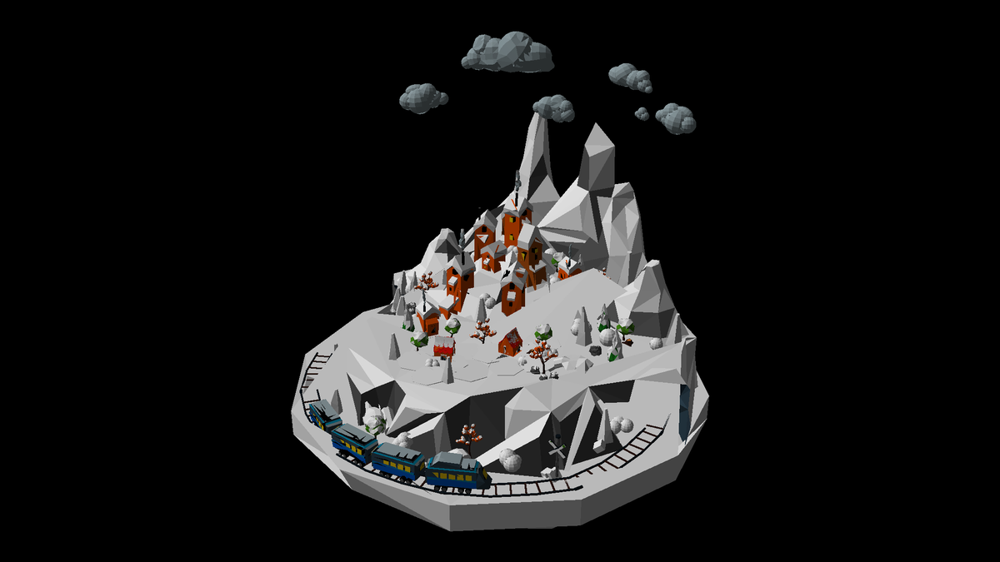
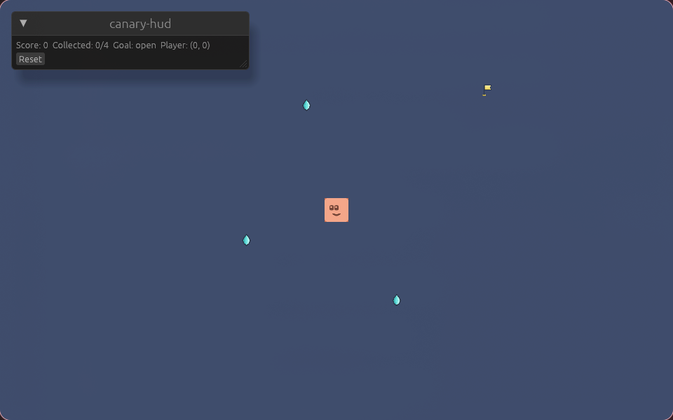
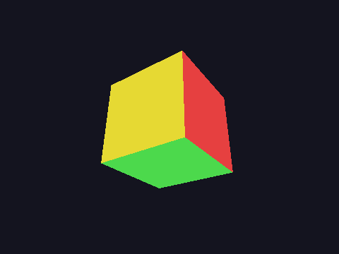

<p align="center">
  <picture>
    <source media="(prefers-color-scheme: dark)" srcset="misc/logo/icon-white.svg">
    
  </picture>
</p>

<h1 align="center">Canary Engine</h1>

<p align="center">
  <a href="https://github.com/HylightGames/canary/actions/workflows/ci.yml"></a>
  <a href="LICENSE"></a>
  <a href="https://github.com/HylightGames/canary/actions/workflows/codspeed.yml"></a>
</p>

Canary is a 2D and 3D game engine written in Rust. It is still being built: it is not ready for production games. There is no editor, no downloadable build, and no crates.io release yet.

A minimal schedule is a few lines — [`examples/spinning-cube`](examples/spinning-cube) is the smallest real program:

```rust
use canary_ecs::World;
use canary_scheduler::Schedule;
use canary_transform::register_transform_propagation;

let mut world = World::new();
let mut schedule = Schedule::new();
register_transform_propagation(&mut schedule);
schedule.run(&mut world);
```

## Screenshots

<p align="center">
  
</p>

<p align="center"><em>A floating island scene rendered through Canary's Vulkan backend. Scene by Matt Connors, <a href="https://creativecommons.org/licenses/by/3.0/">CC BY 3.0</a>, via <a href="https://poly.pizza/m/bmDjSxceaEE">Poly Pizza</a>.</em></p>

<table>
  <tr>
    <td width="50%"><a href="examples/collectathon"></a></td>
    <td width="50%"><a href="examples/spinning-cube"></a></td>
  </tr>
  <tr>
    <td><em>The collectathon sample: 2D physics, pickup audio, and an egui HUD.</em></td>
    <td><em>The offscreen spinning-cube example.</em></td>
  </tr>
</table>

Image credits and licenses: [`misc/screenshots/CREDITS.md`](misc/screenshots/CREDITS.md).

## Project status

`v0.0.16` is the latest tag. The next milestone, `v0.1.0`, is implemented on
`dev` but **not tagged yet**: `examples/collectathon/` is a small playable 2D
game built only on Canary's public APIs, with a deterministic headless twin
and the live-evidence checklist in its README. Two smaller runnable examples
ship alongside it: `examples/ui-game` (windowed rendering, HUD, mapped
actions) and `examples/spinning-cube` (offscreen render to GIF).

Working today: ECS, parallel scheduler, 2D physics (Rapier2D; 3D physics is
post-`v0.1.0`), audio, asset loading, localization, windowed Vulkan
presentation, server-authoritative networking, live collaboration, and native
+ WebAssembly plugins. Deliberately deferred: editor, asset cooking/hot
reload, console support.

There is no crates.io consumer release yet — depend on Canary through a
pinned `git` (or local `path`) dependency, as shown in the
[collectathon README](examples/collectathon/README.md#depending-on-canary-from-your-own-crate-gitpath-route):

```toml
[dependencies]
canary-runtime = { git = "https://github.com/HylightGames/canary", rev = "<pinned dev commit>" }
```

Development happens on `dev`. The status page tracks the current milestone, completed work, and what comes next.

- [Current status](docs/roadmap/status.md)
- [Roadmap handoff](docs/roadmap/README.md)
- [Plan through v0.1.0](docs/roadmap/v0.1.0-plan.md)

## Build from source

You need the stable Rust toolchain. Canary's [`rust-toolchain.toml`](rust-toolchain.toml) selects it when you use rustup. Canary tracks the current stable Rust; there is no MSRV policy yet.

On a fresh Linux checkout the Rust toolchain alone is not enough: windowing and
audio need system packages (the same set CI installs):

```sh
sudo apt-get install -y libwayland-dev libxkbcommon-dev libxrandr-dev libxi-dev libxcursor-dev pkg-config libasound2-dev
```

macOS and Windows need no extra packages.

```sh
git clone https://github.com/HylightGames/canary.git
cd canary
cargo build --workspace
cargo test --workspace
```

To run the windowed sample, use a desktop display and a Vulkan driver. On a
Wayland session, run it with `env -u WAYLAND_DISPLAY` so `winit` takes the X11
path:

```sh
env -u WAYLAND_DISPLAY cargo run -p collectathon --bin collectathon
```

This launches the playable collectathon sample. Build and platform requirements are in the [build guide](docs/development/build-system.md). See the [sample notes](examples/collectathon/README.md) for controls and known limits.

## Documentation

- [Engine architecture](docs/architecture/engine-overview.md)
- [Examples](examples) — [`collectathon`](examples/collectathon) is the `v0.1.0` integration-proof sample
- [Roadmap](docs/roadmap)
- [Architecture decisions](docs/decisions/architecture-decision-records)
- [Distribution](docs/distribution.md)
- [Documentation site](https://hylightgames.github.io/canary/)

## Contributing

Bug reports and feature requests can be filed in [GitHub Issues](https://github.com/HylightGames/canary/issues). Before starting a large change, read the [contribution guide](CONTRIBUTING.md); it explains the project's review and development process.

For security problems, follow the private reporting instructions in [SECURITY.md](SECURITY.md) instead of opening a public issue.

## License

Canary is released under the [MIT License](LICENSE). The `winter-island`
render and other third-party scene assets are licensed separately — see
[`misc/screenshots/CREDITS.md`](misc/screenshots/CREDITS.md).
